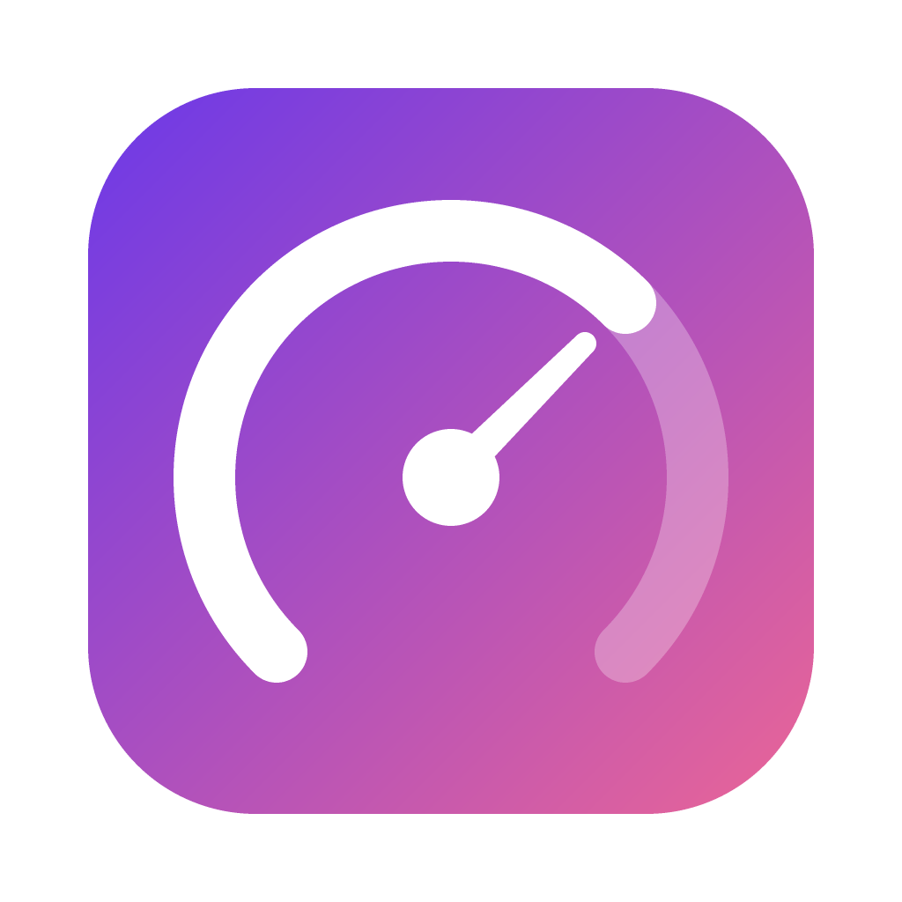
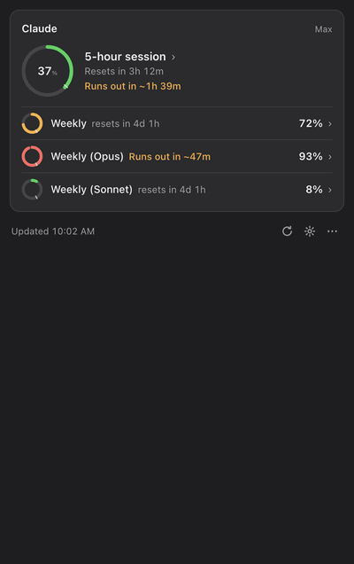

<p align="center"></p>

<h1 align="center">quotapus</h1>

<p align="center"><b>Know how much AI you have left, and when you'll run out.</b></p>

<p align="center">
  <a href="https://github.com/VladUdri/quotapus/releases/latest"></a>
  <a href="https://github.com/VladUdri/quotapus/actions/workflows/ci.yml"></a>
  
  <a href="LICENSE"></a>
  <a href="https://vladudri.github.io/quotapus/"></a>
</p>

<p align="center">
  
</p>

quotapus is a macOS menu bar app that shows how much of your **Claude** and **Cursor** quota you've used,
forecasts when you'll hit the limit, and shows which projects used it.

## Features

- **Forecast.** Estimates when you'll hit the limit from your recent pace ("Runs out in ~1h 39m"). Shown only
  when the limit would be reached before the quota resets.
- **Charts.** Click a meter to see the whole quota window: usage so far, the projected path, and the pace that
  would make it last.
- **Usage by project.** Token share per project folder, read from Claude Code's local logs.
- **Notifications.** At usage thresholds you choose (80% and 95% by default), and when the limit is 30 minutes
  or less away.
- **Clear about stale data.** If a refresh fails, the last values stay visible with a warning, and the menu bar
  shows `~37%` instead of `37%`.
- **No setup.** Uses the logins Claude Code and Cursor already have on your Mac. No account, no server, no telemetry.

## Install

Requires macOS on Apple Silicon or Intel. Run in Terminal:

```bash
curl -fsSL https://raw.githubusercontent.com/VladUdri/quotapus/main/install.sh | bash
```

The installer downloads the latest [release](https://github.com/VladUdri/quotapus/releases) and the official
Electron runtime (checksum-verified) into `~/.quotapus`, adds a `quotapus` command to `~/.local/bin`, and starts
the app. Node is not required.

```bash
quotapus start | stop | update | uninstall
```

`uninstall` also restores your original Claude Code status line (if you enabled "Read limits from Claude Code") and deletes quotapus's settings and history.

## Getting started

Click the gauge icon in the menu bar to open the popup. Right-click the icon for the menu, or click the gear in
the popup for settings: menu bar percentage, notifications, launch at login, refresh interval, and notification
thresholds.

| Provider | Setup | Shows |
|---|---|---|
| **Claude** | Sign in to [Claude Code](https://claude.com/claude-code). | 5-hour session, weekly, and per-model weekly limits, with forecast and per-project breakdown. |
| **Cursor** | Sign in to the Cursor app. When macOS asks to allow access to "Cursor Safe Storage", choose **Always Allow**. | Monthly plan usage, Auto + Composer vs. named models, on-demand spend. |

Cursor support is experimental. Until you sign in to Claude Code, the Claude card shows how to set it up. The
Cursor card is hidden if Cursor isn't installed or signed in.

## How it works

- **Claude:** reads Claude Code's login from the macOS Keychain and queries Anthropic's usage endpoint.
  Optionally, turn on **Read limits from Claude Code** in settings. quotapus then adds a status line command to
  `~/.claude/settings.json` that receives the limits directly from Claude Code, with no extra API calls. Your
  existing status line keeps working, and turning the setting off restores it.
- **Cursor:** reads the access token from Cursor's local state database (read-only) and queries cursor.com's usage endpoint.
- **Forecast:** extrapolates your recent usage rate in a straight line to estimate when you'd reach 100%.

Both usage endpoints are unofficial and may change without notice.

## Troubleshooting

- **"Claude Code's login has expired."** The login lasts about 8 hours and renews whenever Claude Code is used.
  Click **Refresh login** (sends one short message through Claude Code) or use Claude Code.
- **"Rate limited by Anthropic."** Turn on **Read limits from Claude Code** in settings.
- **Cursor data doesn't load.** If Cursor's response isn't recognised, quotapus saves its structure, with all
  values removed, to `~/Library/Application Support/quotapus/cursor-debug.json`. Attach that file to an
  [issue](https://github.com/VladUdri/quotapus/issues).
- **Nothing happens on start.** Only one copy runs at a time. Quit the running one first. The running version is
  shown at the top of the menu.

## Privacy

quotapus connects only to `api.anthropic.com` and `cursor.com`, using logins already on your Mac. It never
refreshes or modifies those logins and has no analytics. Claude Code's logs are read locally for token counts,
model names, and project folder names only, never prompt text. All data quotapus stores is in
`~/Library/Application Support/quotapus`.

## Development

```bash
npm install && npm start                  # run from source
npm test                                  # type-check and unit tests
QUOTAPUS_MOCK=1 npm start                 # use mock data
QUOTAPUS_SNAPSHOT=/tmp/x.png npm start    # save a screenshot of the popup and quit
```

To regenerate `assets/demo.gif`, run `npm run build`, then `node_modules/.bin/electron scripts/make-demo.js`.

Releases are published by GitHub Actions when a `vX.Y.Z` tag is pushed.

Issues and pull requests are welcome.

## License

[MIT](LICENSE). Not affiliated with Anthropic or Cursor.
